# ApartmentHub — Intelligent Multi-Tenant Apartment Management Platform

[](https://github.com/kavishka78/apartment-management-system/actions/workflows/ci.yml)
[](https://dotnet.microsoft.com/)
[](https://react.dev/)
[](https://flutter.dev/)
[](https://fastapi.tiangolo.com/)
[](https://supabase.com/)
[]()

> **Academic Project Reference:** SE3090 — Software Engineering Frameworks (Year 3 Semester 1, SLIIT)  
> **Repository:** [github.com/kavishka78/apartment-management-system](https://github.com/kavishka78/apartment-management-system)

---

## 1. Project Overview & Business Problem

### 1.1 Problem Statement
Modern residential condominiums and gated apartment communities operate in high-density environments requiring coordination between property management companies, unit owners, tenants, maintenance contractors, and on-premise security. In traditional management setups:

- **Operational Silos & Delay:** Maintenance requests are received via fragmented phone calls, physical logbooks, or messaging apps, leading to untracked SLAs, missed repairs, and resident frustration.
- **Security & Access Vulnerabilities:** Visitor passes, vehicle allocations, and domestic staff permissions are recorded on manual paper logs at security gates, lacking verifiable validation and leaving premises exposed to unauthorized entry.
- **Financial Leakage & Dispute:** Utility charges, maintenance fees, and amenity reservations rely on manual invoicing spreadsheets, causing delayed collections, unverified bank slip uploads, and reconciliation discrepancies.
- **Multi-Tenant Complexity:** Property developers manage multiple condominium complexes across different geographical locations with separate rules, subscription plans, and fee structures, requiring rigid multi-tenant data isolation.

### 1.2 Proposed Solution
**ApartmentHub** is an enterprise-grade full-stack residential property management platform with specialized **Agentic AI subsystems**. The platform bridges property management teams, condominium residents, and facility technicians into a synchronized digital workflow:

- **Web Portal (React 19 + Vite):** Administrative dashboard for complex owners, property managers, and facility coordinators to oversee units, verify resident profiles, manage financial invoices, and review AI decision gates.
- **Mobile Application (Flutter):** Resident self-service mobile app providing identity-linked access to book facilities, generate visitor passes, report maintenance issues with photos, and settle monthly invoices via integrated payment gateways.
- **Core API Gateway (ASP.NET Core 8 Web API):** High-performance backend providing strict role-based access control (RBAC), multi-tenant data partitioning, background SLA workers, and database transactions via PostgreSQL (Supabase).
- **Agentic AI Layer (Python FastAPI + LangGraph + Google Gemini):** Autonomous specialized agents that triage maintenance work orders, parse free-form resident onboarding records, query billing ledgers conversationally, and enforce deterministic security safety policies.

---

## 2. User Roles & Access Control Matrix

The platform implements strict Role-Based Access Control (RBAC) enforced through cryptographic JWT claims and database-level tenancy filters:

| Role | Target Platform | Primary Responsibilities & Permissions |
| :--- | :--- | :--- |
| **SuperAdmin** | Web Admin | Global platform governance. Manages apartment complex registrations, allocates SaaS subscription tiers (Standard, Professional, Enterprise), monitors system health, and inspects global AI safety audits across all complexes. |
| **ApartmentAdmin** | Web Admin | Tenant-specific property manager. Manages building units, reviews resident onboarding drafts, dispatches maintenance tickets, approves facility reservations, issues monthly invoices, and reviews AI agent recommendations before execution. |
| **Resident** | Mobile App / Web | Apartment occupant (owner or tenant). Views unit details, registers household members and vehicles, logs domestic staff passes, schedules amenities, reports maintenance faults, and pays invoices via card payment. |
| **Technician** | Web / Mobile | Service personnel (plumbers, electricians, HVAC). Views assigned work orders, updates ticket repair statuses, logs labor/part costs, and submits completion notes. |
| **GateSecurity** | Mobile / Web Kiosk | Security checkpoint staff. Validates visitor QR/access codes, logs visitor check-ins and vehicle check-outs, and verifies domestic staff entry credentials. |

---

## 3. Technology Stack Justification

```
┌────────────────────────────────────────────────────────────────────────┐
│                          PRESENTATION TIER                             │
│     React 19 (Vite) Admin Dashboard   │    Flutter 3.19 Cross-Platform │
│     [Port 5173 / Vercel]              │    Resident App [iOS / Android]│
└───────────────────────────────────┬────────────────────────────────────┘
                                    │ HTTPS / REST (JWT Bearer)
┌───────────────────────────────────▼────────────────────────────────────┐
│                         CORE BACKEND SERVICES                          │
│                   ASP.NET Core 8 Web API Engine                        │
│     - Entity Framework Core 8 (Npgsql) │ - Background SLA Hosted Worker │
│     - JWT Role-Based Authentication    │ - Multi-Tenant Scoping Filters │
│     [Port 5073 / Railway Container Port 8080]                          │
└──────────────┬────────────────────┬────────────────────┬───────────────┘
               │                    │                    │
   HTTP Client │        HTTP Client │        HTTP Client │
   (Port 8000) │        (Port 8001) │        (Port 8002) │
┌──────────────▼─────┐ ┌────────────▼─────┐ ┌────────────▼─────┐
│ MAINTENANCE AGENT  │ │   SAFETY AGENT   │ │ ONBOARDING AGENT │
│ Python FastAPI     │ │ Python FastAPI   │ │ Python FastAPI   │
│ LangGraph Workflow │ │ Policy Engine    │ │ Gemini LLM +     │
│ Gemini 3.8-Flash   │ │ Spend Limits     │ │ Heuristic Regex  │
└────────────────────┘ └──────────────────┘ └──────────────────┘
               │                    │                    │
┌──────────────▼────────────────────▼────────────────────▼───────────────┐
│                       PERSISTENCE & 3RD-PARTY TIER                     │
│  PostgreSQL (Supabase)  │  Stripe Payments  │  SendGrid  │  Firebase   │
└────────────────────────────────────────────────────────────────────────┘
```

| Layer | Technology | Engineering Rationale |
| :--- | :--- | :--- |
| **Backend API** | **ASP.NET Core 8 (.NET 8 LTS)** | Enterprise-grade type safety, asynchronous request pipeline with minimal latency, compiled performance, and first-class EF Core ORM support with global query filters for multi-tenant isolation. |
| **Database** | **PostgreSQL (Supabase)** | Robust relational schema, ACID guarantees for financial transactions, support for foreign key cascades, JSONB fields for dynamic agent workflow outputs, and hosted high-availability cloud infrastructure. |
| **Web Frontend** | **React 19 + Vite** | High-performance SPA with fast hot-module replacement (HMR), modular component design, responsive styling without heavyweight utility bloat, and smooth client-side routing. |
| **Mobile App** | **Flutter 3.19 + Dart** | Single compiled codebase for iOS and Android, pixel-perfect rendering across varied screen resolutions, native hardware access for camera/receipt capture, and responsive offline state management. |
| **Agentic AI** | **Python 3.12 + FastAPI + LangGraph** | Async Python server optimized for high-throughput AI workloads; LangGraph enables structured cyclic state machines and multi-step reasoning loops with deterministic recovery boundaries. |
| **LLM Engine** | **Google Gemini 3.8-Flash** | Low-latency inference, large context window, and native JSON schema enforcement for zero-temperature structured data extraction. |
| **Payment Gateway**| **Stripe SDK** | Industry-standard PCI-DSS compliance, client-side PaymentSheet integration, server-side PaymentIntent lifecycle, and webhook verification with idempotency keys. |
| **Notifications** | **SendGrid API** | Reliable transactional email delivery for access code verification, invoice distribution, and emergency maintenance escalation notifications. |

---

## 4. Agentic AI Subsystem Architecture

Unlike basic conversational chatbots, ApartmentHub implements **Agentic AI Workflows** designed to execute multi-step planning, invoke specialized read-only tools, validate intermediate states, and defer to authorized human operators before executing high-impact database mutations.

```mermaid
flowchart TD
    subgraph Maintenance Triage Pipeline
        A[Complaint Submitted] --> B[Planning Agent]
        B --> C[Complaint Analysis Agent]
        C --> D{Evaluate SLA Risk Tool}
        D --> E[Technician Selection Agent]
        E --> F{Lookup Technicians Tool}
        F --> G[Safety Validation Agent]
        G --> H{Passes Business Rules?}
        H -- No --> I[Deterministic Safe Fallback]
        H -- Yes --> J[Human-in-the-Loop Approval Gate]
        J --> K[Manager Approved: Database Update]
    end

    subgraph Resident Onboarding Pipeline
        L[Unstructured Text Input] --> M[Gemini LLM Extraction]
        M -- Failure / Timeout --> N[Heuristic Regex Parser]
        M -- Success --> O[Extracted Resident Draft]
        N --> O
        O --> P[Database Constraint Validator]
        P --> Q[Reviewable Draft for Property Manager]
    end

    subgraph Safety Policy Engine
        R[Proposed Agent Action] --> S[Schema & Injection Sanitizer]
        S --> T[Tenant Boundary Check]
        T --> U[Role Permission Check]
        U --> V{Spend <= LKR 25,000?}
        V -- Yes --> W[Auto-Approved Verdict Log]
        V -- No --> X[Flagged for Manager Approval]
    end
```



### 4.1 Maintenance Triage Agent (`Port 8000`)
- **Orchestration:** Built with **LangGraph** using a stateful directed graph (`graph.py`, `agent.py`).
- **Execution Cycle:**
  1. `PlanningAgent`: Generates an immutable 4-step sequence: *Analysis -> Candidate Selection -> Safety Validation -> Approval Gate*.
  2. `ComplaintAnalysisAgent`: Invokes Gemini to categorize issues into `Plumbing`, `Electrical`, `Carpentry`, `HVAC`, `Appliance`, or `General` and assigns priority (`Low`, `Medium`, `High`, `Urgent`). Calls the deterministic tool `evaluate_sla_risk` based on ticket age.
  3. `TechnicianSelectionAgent`: Invokes `lookup_eligible_technicians` tool. Filters candidate technicians by matching trade specialty, active availability status, and lowest current workload.
  4. `SafetyValidationAgent`: Deterministically verifies the model's output schema, ensuring technician IDs belong strictly to the complex's eligible contractor pool.
  5. `ApprovalGate`: The agent pauses and surfaces recommendations to the Property Manager via the Web UI (`/admin/ai-approvals`). Technicians are never assigned without explicit human authorization.
- **Fail-Safe Mechanism:** If Gemini API exceeds a 20-second threshold or fails schema validation, the agent automatically drops to `_heuristic_result`, applying keyword rules to protect operational uptime.

### 4.2 Deterministic Safety & Validation Agent (`Port 8001`)
- **Purpose:** Acts as an immutable security guardrail protecting backend controllers from unauthorized agent actions or prompt injection exploits.
- **Enforced Policies (`policy.py`):**
  - **Tenant Boundary Enforcement:** Checks that `requester.tenantId == action.targetTenantId`. Cross-tenant manipulation attempts are immediately rejected with a recorded violation log.
  - **Role-Based Action Permissions:** Restricts action types (`approve_repair`, `book_amenity`, `view_resident_data`, `update_vehicle`) strictly to designated roles.
  - **Spend Limit Guardrail:** Any maintenance expenditure exceeding **LKR 25,000** automatically triggers `RequiresApproval = true`, preventing automated financial loss.
  - **Prompt Injection Defense (`injection.py`):** Scans inputs for instruction override patterns (e.g., `ignore previous instructions`, `grant admin`, system prompt leak attempts) and flags malicious payloads.

### 4.3 Resident Onboarding Assistant (`Port 8002`)
- **Purpose:** Ingests free-form resident registration notes (emails, rental agreements, handwritten message transcripts) and outputs validated resident profiles (`extraction.py`).
- **Processing Logic:**
  - Extracts full name, phone number, email, NIC number, allocated unit, vehicle plate numbers, emergency contact, move-in date, and household dependents.
  - Dual extraction pipelines: **Gemini 3.8-Flash** (zero-temperature JSON output) with automatic fallback to **Heuristic Regex** label matching (`extract_with_rules`).
  - Read-Only Drafting: The agent creates a draft in memory. The Property Manager must review and click "Confirm Onboard" to commit the resident to the database.

### 4.4 Conversational Payment Assistant (`Port 8001`)
- **Purpose:** Answers resident billing queries inside the mobile app chat interface (`payment-agent/agent.py`).
- **Security & Integrity Rules:**
  - Reuses the mobile user's signed JWT session (`Authorization: Bearer <token>`). The agent forwards the token to the backend's `/api/v1/auth/me` to resolve the caller's verified `residentId` and `tenantId`.
  - Strictly read-only: Can query outstanding invoices, explain billing breakdowns, and check past receipt histories. Cannot perform database writes or waive balances.
  - Zero-Balance Guardrail: Backend outages return an explicit connection error; the agent is explicitly prohibited from generating an invented zero balance.
  - Handoff to Stripe: When the resident chooses to pay, the agent returns an invoice ID payload that triggers the native Flutter `CardPaymentScreen` and Stripe PaymentSheet.

---

## 5. Repository Structure

```
apartment-management-system/
├── backend/                               # ASP.NET Core 8 Web API
│   ├── ApartmentManagement.Api/           # Primary API Microservice
│   │   ├── Controllers/                   # REST Controllers (Facility, Maintenance, Payment, Registry, Safety)
│   │   ├── Data/                          # AppDbContext, RegistrySeeder, FacilitySeeder
│   │   ├── DTOs/                          # Data Transfer Objects
│   │   ├── Migrations/                    # EF Core Database Migrations
│   │   ├── Models/                        # Domain Models (Complex, Unit, Resident, Invoice, etc.)
│   │   ├── Services/                      # JWT, Email, SLA Worker, Agent HTTP Clients
│   │   ├── appsettings.json               # Configuration template
│   │   └── Program.cs                     # Application bootstrap & middleware pipeline
│   ├── ApartmentManagement.Tests/         # xUnit Integration & Controller Tests
│   └── PaymentSecurity.Tests/             # Automated Payment & JWT Ownership Verification
├── web/                                   # Frontend Single Page Application
│   └── apartment-management-web/          # React 19 + Vite Project
│       ├── src/
│       │   ├── api/ & services/           # Axios / Fetch API wrappers (api.js, maintenanceApi.js)
│       │   ├── components/                # Reusable UI components & modals
│       │   ├── context/                   # React Context (AuthContext, ThemeContext)
│       │   └── pages/                     # Admin & SuperAdmin Dashboards
│       │       ├── admin/                 # Units, Residents, Facilities, Visitors, AI Approvals
│       │       ├── superadmin/            # Complexes, Subscriptions, AI Governance
│       │       ├── maintenance/           # Complaints, Work Orders, Technician Dispatch
│       │       └── payment/               # Invoices, Overdue Accounts, Collection Reports
│       └── package.json                   # NPM dependencies & test scripts
├── mobile/                                # Resident Mobile Application
│   └── lib/                               # Flutter 3.19 Source Code
│       ├── models/                        # Dart Domain Models
│       ├── screens/                       # Auth, Facility Booking, Maintenance, Parking, Payment Chat
│       ├── services/                      # ApiConfig, AuthService, Storage, StripeService
│       └── widgets/                       # Reusable Flutter UI Widgets
├── agent-services/                        # Agentic AI Microservices (Python FastAPI)
│   ├── maintainance-agent/                # LangGraph Maintenance Triage Agent (Port 8000)
│   ├── safety-agent/                      # Deterministic Policy & Validation Agent (Port 8001)
│   ├── onboarding-agent/                  # Gemini Resident Extraction Agent (Port 8002)
│   ├── payment-agent/                     # Resident Billing Chat Assistant (Port 8001)
│   └── run_all_agents.py                  # Process launcher for all Python agents
├── maintenance-tests/                     # Cross-platform Maintenance Verification Suites
│   ├── agent/                             # Pytest agent orchestration tests & benchmarks
│   ├── backend/                           # xUnit Maintenance Controller Tests
│   ├── mobile/                            # Flutter workflow integration tests
│   └── pytest.ini                         # Pytest configuration
├── .github/workflows/                     # GitHub Actions CI Automation
│   └── ci.yml                             # Automated build & test pipeline for all components
├── Dockerfile                             # Multi-stage production container build for .NET API
└── README.md                              # Technical documentation
```

---


## 7. Environment Variables & Configuration

Create local environment configuration files using the templates below.

### 7.1 Backend API (`backend/ApartmentManagement.Api/.env`)
```ini
# PostgreSQL Connection (Supabase or local instance)
ConnectionStrings__DefaultConnection=Host=aws-0-ap-southeast-2.pooler.supabase.com;Port=5432;Database=postgres;Username=postgres.youruser;Password=YourPassword;SSL Mode=Require;Trust Server Certificate=true

# JWT Authentication (Key must be at least 32 characters)
Jwt__Key=JWT_KEY
Jwt__Issuer=ApartmentHub
Jwt__Audience=ApartmentHubClients
Jwt__ExpiryHours=(Hours)

# Email Service (SendGrid)
SendGrid__ApiKey=SG.your_sendgrid_api_key_here
SendGrid__SenderEmail=notifications@yourdomain.com
SendGrid__SenderName=Apartment Management

# Agent Microservice Endpoints
PythonAgentUrl=http://localhost:8000
SafetyAgentUrl=http://localhost:8001
OnboardingAgentUrl=http://localhost:8002

# Payment Processing (Stripe)
STRIPE_SECRET_KEY=sk_test_your_stripe_secret_key_here
```

### 7.2 Web Frontend (`web/apartment-management-web/.env.local`)
```ini
# Local development API endpoint
VITE_API_BASE_URL=http://localhost:5073/api
```

### 7.3 Python AI Agents (`agent-services/.env`)
```ini
# Google Gemini API Key (required for Maintenance, Onboarding, and Payment agents)
GEMINI_API_KEY=your_gemini_api_key_here
GEMINI_MODEL=gemini-3.8-flash

# Core Backend URL for Payment Agent verification
BACKEND_API_URL=http://localhost:5073/api
```

### 7.4 Mobile Application (`mobile/.env`)
```ini
# Android Emulator uses 10.0.2.2 to connect to host localhost
# Physical device or Web uses the hosted production URL or your local LAN IP
API_URL=http://10.0.2.2:5073/api
```

---

## 8. Installation & Local Development Setup

### Prerequisites
- **.NET 8.0 SDK** ([dotnet.microsoft.com](https://dotnet.microsoft.com/download))
- **Node.js 18+ & npm** ([nodejs.org](https://nodejs.org/))
- **Python 3.10 to 3.12** ([python.org](https://www.python.org/))
- **Flutter SDK 3.19+ & Dart** ([flutter.dev](https://flutter.dev/))
- **Git**

---

### Step 1: Clone the Repository
```bash
git clone https://github.com/kavishka78/apartment-management-system.git
cd apartment-management-system
```

---

### Step 2: Backend Database Setup & Launch
```bash
cd backend/ApartmentManagement.Api

# Restore NuGet dependencies
dotnet restore

# Apply Entity Framework Core migrations to your PostgreSQL database
dotnet ef database update

# Run the API server (starts on http://localhost:5073 with Swagger on /swagger)
dotnet run
```
*Note: On initial startup, `Program.cs` automatically executes `RegistrySeeder.cs` and `FacilitySeeder.cs` to seed default complexes, test accounts, units, and facilities.*

---

### Step 3: Launch AI Agent Microservices
Open a second terminal:
```bash
cd agent-services

# Create and activate virtual environment
python -m venv venv

# Windows:
venv\Scripts\activate
# macOS/Linux:
# source venv/bin/activate

# Install shared requirements
pip install -r maintainance-agent/requirements.txt
pip install -r safety-agent/requirements.txt
pip install -r onboarding-agent/requirements.txt
pip install -r payment-agent/requirements.txt

# Option A: Start all agents concurrently using the orchestrator script
python run_all_agents.py

# Option B: Run agents individually in dedicated terminal windows
# Terminal - Maintenance Agent:
# uvicorn maintainance-agent.main:app --port 8000 --reload
# Terminal - Safety Agent:
# uvicorn safety-agent.main:app --port 8001 --reload
# Terminal - Onboarding Agent:
# uvicorn onboarding-agent.main:app --port 8002 --reload
```

---

### Step 4: Launch Web Admin Dashboard
Open a third terminal:
```bash
cd web/apartment-management-web

# Install NPM dependencies
npm install

# Start Vite development server (starts on http://localhost:5173)
npm run dev
```

---

### Step 5: Launch Flutter Mobile Application
Open a fourth terminal:
```bash
cd mobile

# Fetch Flutter packages
flutter pub get

# Launch on connected Android Emulator, iOS Simulator, or Chrome
flutter run
```
*Tip for Android Emulator: Run `flutter run -d emulator`.*

---

## 9. Seeded Test Accounts

The following demonstration credentials are pre-seeded into the database for immediate testing:

| Role | Username / Email | Password | Access Scope & Complex |
| :--- | :--- | :--- | :--- |
| **SuperAdmin** | `owner@apartmenthub.io` | `owner123` | Global platform administration, all complexes |
| **ApartmentAdmin** | `nimal.f@lotusgrand.lk` | `admin123` | Lotus Grand Residencies (Complex ID: 1) |
| **ApartmentAdmin** | `saman.k@cinnamonbreeze.lk`| `admin123` | Cinnamon Breeze Condos (Complex ID: 2) |
| **Technician** | `technician@apartment.lk` | `tech12345` | Assigned maintenance work orders |
| **Resident** | `kamal.perera@gmail.com` | *Mobile Login* | Unit A-101 (Lotus Grand Residencies) |
| **Resident** | `anoma.j@asiri.lk` | *Mobile Login* | Unit B-201 (Lotus Grand Residencies) |

---

## 10. API Route Reference

The ASP.NET Core Web API routes follow the `/api/v1` namespace convention. When running locally, interactive OpenAPI documentation is available at `http://localhost:5073/swagger`.

### Authentication & Platform Governance
- `POST /api/v1/auth/login` — Authenticate user and issue signed JWT bearer token.
- `POST /api/v1/auth/google` — Authenticate via Google OAuth credentials.
- `GET  /api/v1/auth/me` — Resolve active profile, tenant context, and permissions.
- `GET  /api/v1/complexes` — Retrieve registered apartment complexes (*SuperAdmin*).
- `POST /api/v1/complexes` — Register new complex with subscription package.
- `POST /api/v1/admins` — Provision new apartment complex manager account.

### Unit & Resident Registry
- `GET  /api/v1/tenants/{tenantId}/units` — List building units with occupancy status.
- `POST /api/v1/units` — Add new unit to building registry.
- `GET  /api/v1/residents?tenantId={id}` — List residents with allocated parking and units.
- `POST /api/v1/residents/onboard-draft` — Ingest raw text and return AI-parsed draft.
- `POST /api/v1/residents/onboard` — Confirm and persist resident profile to database.
- `GET  /api/v1/vehicles?tenantId={id}` — Retrieve registered resident vehicles.
- `GET  /api/v1/staff?tenantId={id}` — Retrieve registered domestic staff with access codes.

### Maintenance & Complaint Management
- `GET  /api/v1/maintenance` — Retrieve maintenance complaints with SLA urgency flags.
- `POST /api/v1/maintenance` — Submit resident complaint with photo evidence.
- `POST /api/v1/maintenance/{id}/triage` — Trigger LangGraph AI triage agent pipeline.
- `POST /api/v1/maintenance/{id}/assign` — Assign technician to work order.
- `PATCH /api/v1/maintenance/{id}/status` — Update repair ticket status (*In Progress*, *Resolved*).
- `GET  /api/v1/technicians` — List registered technicians and active availability.

### Facilities & Visitor Access
- `GET  /api/v1/facilities` — Retrieve complex amenities (pool, gym, banquet hall).
- `POST /api/v1/bookings` — Schedule facility booking with slot collision checks.
- `PUT  /api/v1/bookings/{id}/approve` — Approve pending facility reservation.
- `GET  /api/v1/visitors/active` — List visitors currently on-premise.
- `POST /api/v1/visitors/{id}/check-in` — Check-in visitor via unique access pass code.
- `POST /api/v1/visitors/{id}/check-out` — Record visitor exit timestamp.
- `GET  /api/v1/parkingslots` — Retrieve real-time visitor/resident parking slot status.

### Payments & Invoicing
- `GET  /api/v1/invoices` — List resident monthly maintenance and facility invoices.
- `POST /api/v1/invoices/generate-monthly` — Trigger batch invoice generator for complex units.
- `POST /api/v1/payments/create-intent` — Initialize Stripe PaymentIntent with idempotency key.
- `POST /api/v1/payments/confirm` — Validate Stripe payment completion and issue receipt.
- `GET  /api/v1/reports/revenue` — Aggregate monthly collection and overdue metrics.

### AI Safety & Governance
- `POST /api/v1/safety/validate` — Validate proposed agent action against deterministic rules.
- `GET  /api/v1/safety/verdicts` — Retrieve audit log of all safety checks and spend triggers.
- `POST /api/v1/safety/verdicts/{id}/decision` — Record property manager approval or rejection.

---

## 11. Test Execution & Verification

The test strategy covers unit, integration, and security tests across all technological layers.

### 11.1 Backend Test Suites (.NET xUnit)
```bash
# Run core backend tests (Facility, Parking, Visitor Pass controllers & DB constraints)
dotnet test backend/ApartmentManagement.Tests

# Run Payment Security & JWT claims isolation verification
dotnet run --project backend/PaymentSecurity.Tests -- agent-services/payment-agent/venv/Scripts/python.exe

# Run Maintenance backend tests
dotnet test maintenance-tests/backend/ApartmentManagement.Maintenance.Tests.csproj
```

### 11.2 AI Agent Test Suites (Pytest)
```bash
# Safety Agent policy tests (24 unit tests covering role permissions, spend limits, injection detection)
cd agent-services/safety-agent
pytest test_safety.py -v

# Resident Onboarding Agent tests (13 unit tests covering Gemini & regex fallback parsing)
cd ../onboarding-agent
pytest test_onboarding.py -v

# Payment Agent security & intent classification tests
cd ../payment-agent
pytest test_security.py -v

# Full maintenance agent integration benchmark
cd ../..
python -m pytest -c maintenance-tests/pytest.ini maintenance-tests/agent
```

### 11.3 Web Frontend Tests (Vitest)
```bash
cd web/apartment-management-web
npm test
```

### 11.4 Mobile Application Tests (Flutter Test)
```bash
cd mobile
flutter analyze
flutter test
flutter test test/payment_chat_test.dart
```

---

## 12. Deployment & Live Environments

### 12.1 Live Service Endpoints
- **Production Backend API:** `https://apartment-management-system-production.up.railway.app`
- **Interactive Swagger Documentation:** `https://apartment-management-system-production.up.railway.app/swagger`
- **Database Service:** Managed PostgreSQL cluster on [Supabase](https://supabase.com/) (AWS AP-Southeast-2)

### 12.2 Docker Production Deployment
The backend API is containerized using multi-stage Docker builds:
```bash
# Build the production Docker image
docker build -t apartment-management-api .

# Run the containerized API locally on port 8080
docker run -d -p 8080:8080 \
  -e ConnectionStrings__DefaultConnection="Host=...;Database=...;Username=...;Password=..." \
  -e Jwt__Key="dev-only-change-me-in-production-0123456789abcdef" \
  apartment-management-api
```

## 15. Team & Individual Module Ownership

This project was developed by a team of 4 software engineering students for the **SE3090 — Software Engineering Frameworks** course at SLIIT. Each team member held full end-to-end ownership over an architectural module across the database, backend, web frontend, mobile application, test suites, and AI agent integration:

| Team Member | Subsystem / Module | Key Architectural Contributions & Deliverables |
| :--- | :--- | :--- |
| **Bimsara Bandara**<br>`bandarabimsara10@gmail.com` | **Facility & Visitor Parking Management** | - Facility booking engine with collision prevention & hourly pricing.<br>- Visitor pass lifecycle with access pass code verification and parking slot allocations.<br>- Backend controllers (`FacilitiesController`, `BookingsController`, `VisitorsController`, `ParkingSlotsController`).<br>- React facility and visitor admin portals; Flutter resident booking screens.<br>- Automated xUnit test suite for facility and parking validation (`ApartmentManagement.Tests`). |
| **Dinujaya Kavishka**<br>`kavishkastc@gmail.com` | **Smart Payments & Invoicing Management** | - Stripe PaymentSheet & PaymentIntent lifecycle integration.<br>- Monthly billing batch generator, invoice item calculations, and overdue tracking.<br>- Conversational Payment Assistant Agent (`payment-agent`) with zero-balance hallucination defense.<br>- Backend payment controllers (`InvoicesController`, `PaymentsController`, `ReportsController`).<br>- React billing dashboards and Flutter mobile payment chat screen.<br>- Payment security integration suite (`PaymentSecurity.Tests`). |
| **Ashan Akalanka**<br>`ashanakalanka600@gmail.com` | **Maintenance & Complaint Management** | - Complaint lifecycle tracking with SLA escalation background worker (`SlaEscalationService`).<br>- Technician scheduling, trade matching, and workload distribution.<br>- Multi-agent LangGraph triage pipeline (`maintainance-agent`) with fallback heuristic analysis.<br>- Backend controllers (`MaintenanceController`, `TechniciansController`, `ReportsController`).<br>- Web dispatch board and Flutter maintenance reporting UI with photo attachments.<br>- Cross-platform maintenance test suite (`maintenance-tests`). |
| **ChandupaS (Chandupa)**<br>`isthisperfecto24@gmail.com` | **Resident Onboarding & Tenant Registry** | - Multi-tenant apartment complex registry, unit generator, and SuperAdmin SaaS governance.<br>- Resident registration engine, household members, vehicle, and domestic staff passes.<br>- LLM-powered Resident Onboarding Assistant (`onboarding-agent`) using Gemini with regex fallback.<br>- Deterministic Safety & Validation Agent (`safety-agent`) enforcing spend limits and tenant isolation.<br>- Backend controllers (`PlatformController`, `RegistryController`, `SafetyController`).<br>- React SuperAdmin & resident management portals; mobile onboarding flows. |

---

## 16. Academic & AI Usage Declaration

In compliance with academic integrity guidelines for SE3090:
- **Core Domain & Business Logic:** The architectural design, database schemas, multi-tenant security filters, API controllers, and frontend/mobile UI workflows were designed and implemented by the project team members.
- **AI in Application Features:** Generative AI (Google Gemini 3.8-Flash) is used strictly as a runtime feature within controlled microservices (natural language extraction, complaint triage suggestions, and billing inquiries) governed by deterministic code guardrails.
- **AI Development Tools:** AI coding assistants were utilized as supplementary pair-programming tools for code refactoring, test case fixture generation, and syntax assistance. All generated code was manually inspected, modified, verified, and tested against project requirements.
